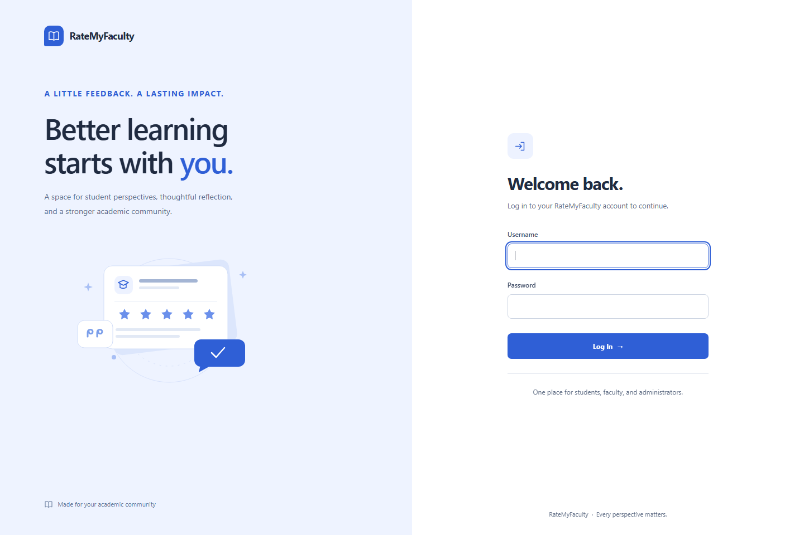
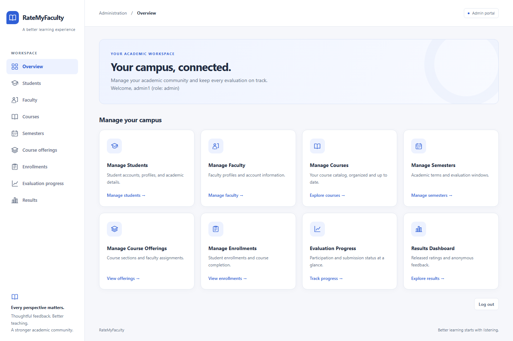
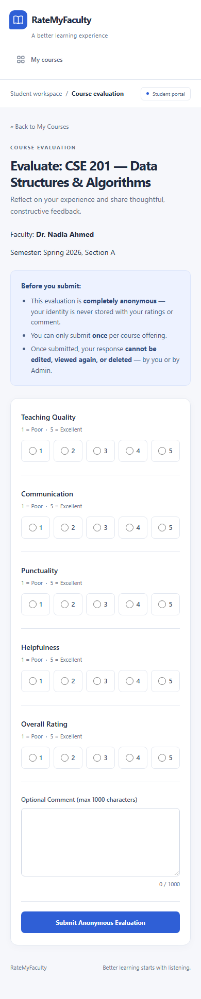

# RateMyFaculty UI redesign

The redesign is integrated into the existing PHP templates. No package installation, build step, database migration, or configuration change is needed. Each changed template contains `UI REDESIGN` comments; all visual rules live in the shared stylesheet.

## Analysis and visual direction

The project is a server-rendered PHP application with 17 primary pages: login, 11 administrator pages, two student pages, and three faculty pages. Additional full HTML views handle evaluation eligibility, rejected submissions, and access denial. The original interface used a blue accent, light neutral background, system fonts, basic forms, and tables.

The new interface retains that identity in one light theme: cobalt blue actions, white panels, a soft neutral canvas, consistent spacing, and local line icons. Role navigation becomes a left rail on desktop and a horizontally scrollable row on mobile. Management forms use two columns where space allows and one column on smaller screens. Dashboard cards link to existing pages without adding fabricated statistics or new features.

The original broad `body:has(form):not(:has(table))` layout rule is replaced with explicit page classes. This keeps login centering from unintentionally affecting dashboards, empty views, and evaluation forms. Invalid paragraph/form nesting on the student and faculty dashboards is replaced with a valid session bar.

## Redesigned code for each page

These links point to the complete, ready-to-use source files. Existing PHP processing and output expressions remain in their templates.

| Page | Redesigned source | Presentation changes |
| --- | --- | --- |
| Login | [login.php](login.php) | Light split layout, original login form, local feedback illustration, visible error state. |
| Administrator overview | [admin/dashboard.php](admin/dashboard.php) | Welcome panel, eight navigation cards, role navigation, original logout form. |
| Students | [admin/students.php](admin/students.php) | Responsive account editor, grouped fields, refined account table and actions. |
| Faculty management | [admin/faculty.php](admin/faculty.php) | Matching profile editor, status labels, compact row actions. |
| Courses | [admin/courses.php](admin/courses.php) | Course editor and catalog table with consistent hierarchy. |
| Semesters | [admin/semesters.php](admin/semesters.php) | Aligned date inputs, lock notice, readable semester table. |
| Course offerings | [admin/offerings.php](admin/offerings.php) | Consistent course, semester, faculty, and section field groups. |
| Enrollments | [admin/enrollments.php](admin/enrollments.php) | Enrollment panel and clearer completion, deletion, and locked states. |
| Evaluation progress | [admin/progress.php](admin/progress.php) | Participation table, clear page description, retained operational privacy note. |
| Student submission status | [admin/progress_detail.php](admin/progress_detail.php) | Course context, participation-only note, focused student status table. |
| Results dashboard | [admin/results.php](admin/results.php) | Offering availability table, released-state labels, accessible action targets. |
| Administrator result detail | [admin/result_detail.php](admin/result_detail.php) | Response count panel, emphasized averages, separate comment cards. |
| Student courses | [student/dashboard.php](student/dashboard.php) | Session bar, enrollment/window/submission labels, scrollable course table. |
| Faculty evaluation | [student/evaluate.php](student/evaluate.php) | Submission guidance panel, fieldsets and legends, five native radio groups, comment area; also styles the ineligible view. |
| Submission errors | [student/submit_evaluation.php](student/submit_evaluation.php) | Consistent rejection and validation-error documents; submission processing remains intact. |
| Faculty offerings | [faculty/dashboard.php](faculty/dashboard.php) | Session bar, summary link, readable offering and release-status table. |
| Faculty overall summary | [faculty/summary.php](faculty/summary.php) | Count panels, consistent average table, clear empty state. |
| Faculty offering results | [faculty/offering_result.php](faculty/offering_result.php) | Matching response summary and comment cards; hidden-result conditions preserved. |
| Access denied | [includes/authorization.php](includes/authorization.php) | Only the existing 403 renderer's HTML strings change, creating a themed error panel. |

## Shared presentation code

| File | Purpose |
| --- | --- |
| [assets/css/style.css](assets/css/style.css) | Shared theme, navigation, panels, forms, tables, rating controls, errors, responsive and print styles. |
| [assets/icons.svg](assets/icons.svg) | Local decorative icon sprite, used by navigation, branding, and dashboard cards. |
| [assets/feedback-illustration.svg](assets/feedback-illustration.svg) | Decorative login illustration; contains no application data. |

Core theme tokens:

```css
:root {
  color-scheme: light;
  --bg: #f6f7fb;
  --surface: #fff;
  --text: #202b41;
  --muted: #637087;
  --border: #e2e7f0;
  --accent: #2f5fd6;
  --accent-hover: #234ab0;
  --accent-soft: #edf2ff;
  --radius: 14px;
}
```

Accessibility improvements include viewport metadata, skip links, main landmarks, active-navigation semantics, associated form labels, native radio inputs with group legends, table column scopes, keyboard-scrollable table regions, visible focus styles, error/status roles, reduced-motion support, and forced-colors outlines. Information remains available as text rather than relying on color alone. These are targeted improvements, not a claim of a complete accessibility certification.

## Verification

- All 31 PHP files pass `php -l`. The unchanged JavaScript passes `node --check`.
- Compared the original and updated PHP token streams, excluding HTML/whitespace and the 403 renderer's literal HTML strings: executable application logic is unchanged.
- Compared original and updated form tags and rendered controls: methods, actions, field names, types, values, selected options, validation constraints, and confirmation handlers are preserved.
- Confirmed all original link and script destinations remain present. JavaScript, SQL, configuration, authentication, CSRF, eligibility, evaluation-window, and result-release helpers remain unchanged, apart from literal 403 presentation markup in the authorization file.
- Rendered 51 template states with synthetic data, including create/edit forms, errors, success messages, locked semesters, empty lists, withheld results, and released results. Also rendered the real 403 presentation, for 52 previews total.
- Completed 146 Chromium layout checks across 1440, 768, 390, and 320 pixel widths, with no document overflow, duplicate IDs, missing form labels, missing table header scopes, or invisible controls detected.
- Verified radio selection using mouse and keyboard, the existing comment counter, keyboard scrolling of wide tables, and dismissing an error alert. Reviewed representative desktop and mobile screenshots.

Browser previews used isolated synthetic fixtures because the local database-backed application was not running. No database records were read or changed during this redesign. Live authentication, administrative writes, and evaluation submissions were not exercised; preservation is supported by source and form-contract comparisons rather than a claim of end-to-end backend testing.

Redirect-only handlers and plain-text diagnostics remain unchanged. The preview fixtures and verification scripts are outside the application directory; they are not runtime dependencies.

## Visual previews

The screenshots below show synthetic review data.







No application logic was changed. One light theme is applied across all redesigned pages and full HTML error views.
